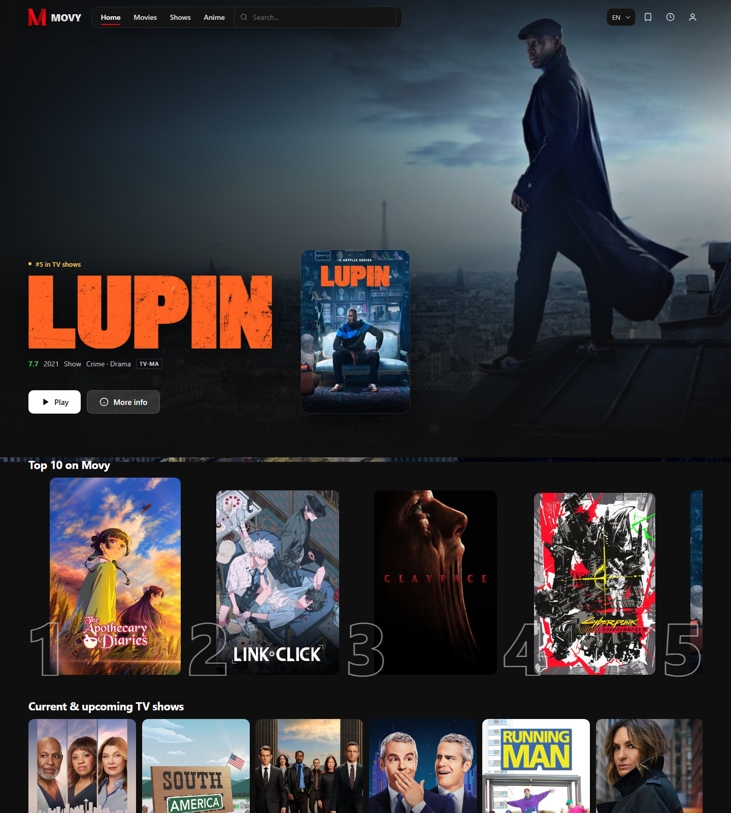
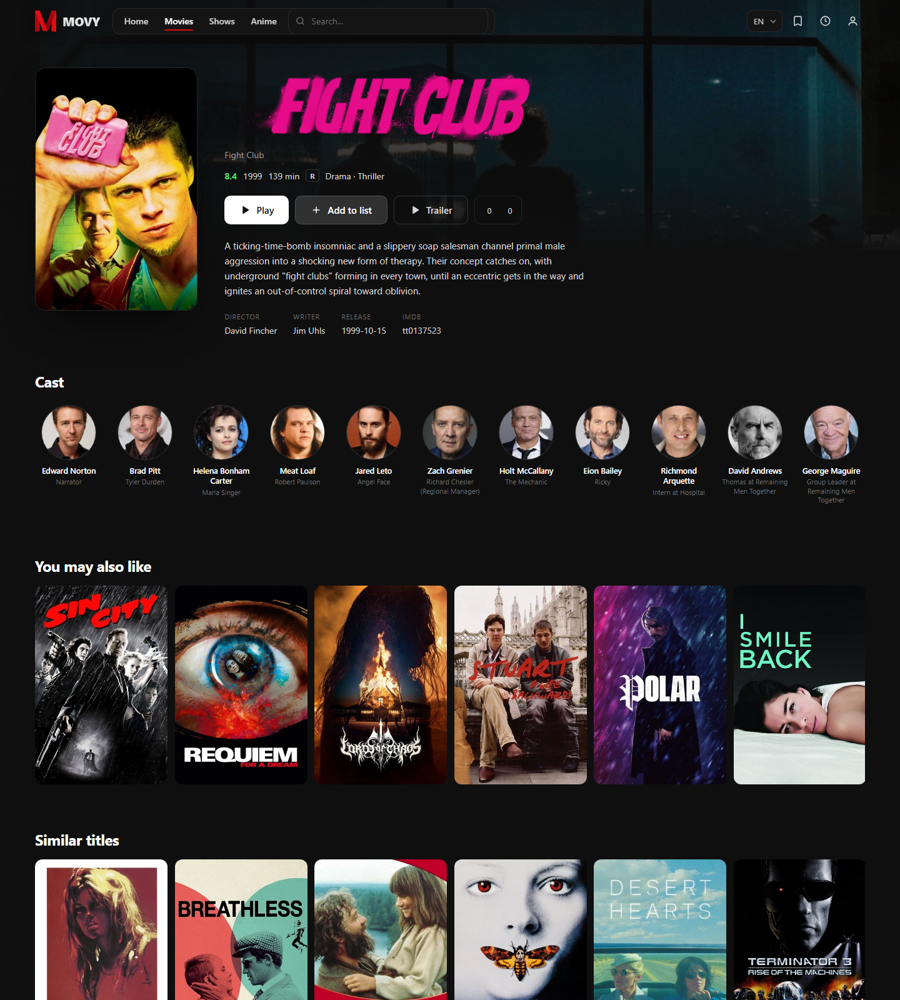
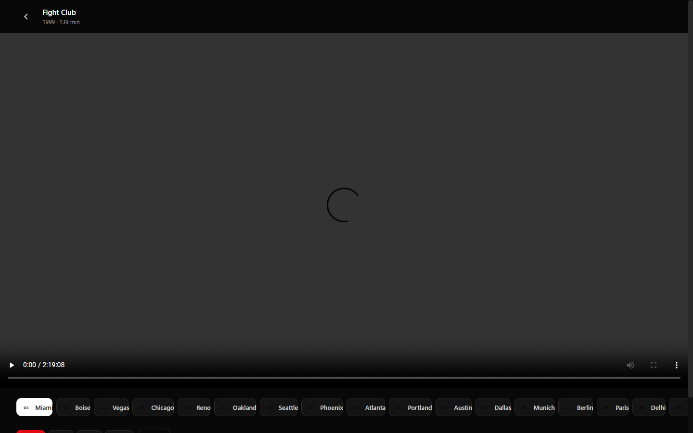
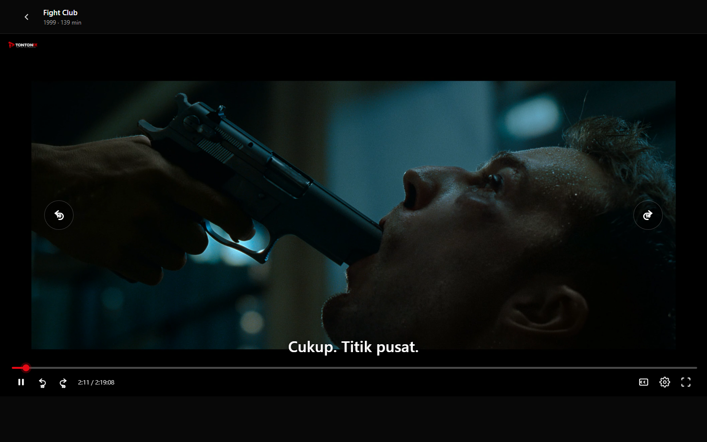
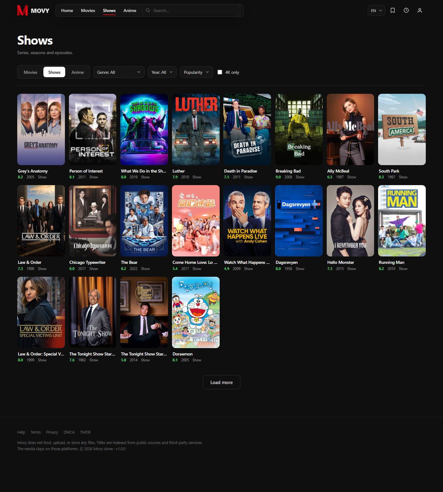
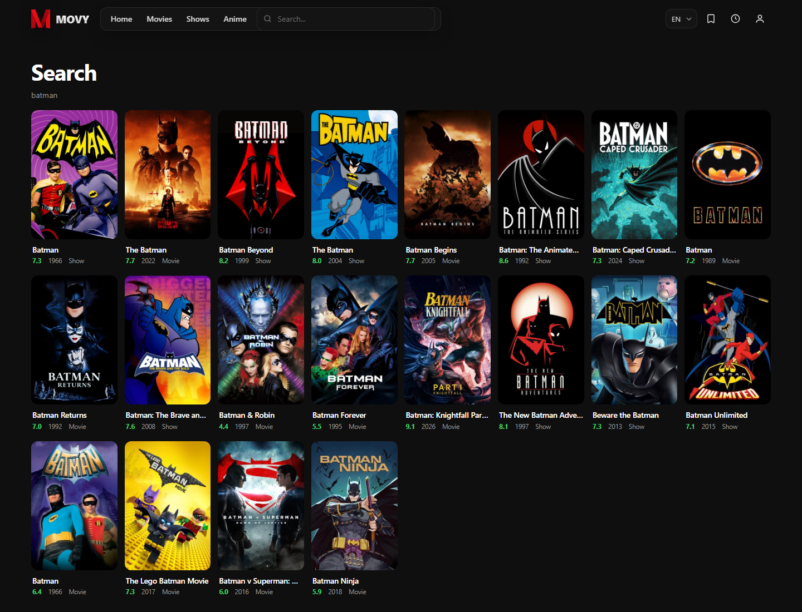

<div align="center">


**A streaming front end that actually plays.**

TMDB catalog · 17 stream providers · full subtitle variant list · zero npm dependencies

[](https://nodejs.org)
[](#quick-start)
[](LICENSE)
[](#project-layout)
[](#)

[Quick start](#quick-start) · [Screenshots](#screenshots) · [How it works](#how-it-works) · [API](#api) · [Config](#configuration)

</div>

---

## What this is

Tontonix is a self-hosted movie and TV streaming front end. It talks to a TMDB-compatible
catalog, resolves playable sources from a provider gateway, and plays them in the browser
through a local proxy — no browser extension, no exposed referer, no API keys.

Everything is built on Node built-ins (`node:http`, `fetch`, `crypto`) and a vanilla
ES-module SPA. There is no build step and there are no npm packages to install.

```bash
node server.js
# Tontonix listening on http://127.0.0.1:3000
```

### Highlights

| | |
| --- | --- |
| **Full catalog** | Home rows, paged browse with genre/year/sort filters, multi-search, detail pages with cast, seasons, recommendations and trailers |
| **17 providers** | Resolved in order, decrypted locally, first healthy source wins; automatic retry on seed expiry |
| **Real subtitles** | Complete variant list per title — not one row per language — converted to WebVTT on the fly |
| **Custom subtitle rendering** | Transparent background, selectable text color and size, persisted per browser |
| **Accounts** | `scrypt` password hashing, HS256 tokens, watchlist, history, votes |
| **Stream proxy** | Manifest rewriting, range passthrough, referer spoofing at the server edge |
| **Bilingual UI** | English and Indonesian, switchable at runtime |

---

## Screenshots

<table>
<tr>
<td width="50%"><br /><sub><b>Home</b> — hero, trending, top 10, genre rows</sub></td>
<td width="50%"><br /><sub><b>Detail</b> — cast, seasons, recommendations, trailer</sub></td>
</tr>
<tr>
<td width="50%"><br /><sub><b>Player</b> — custom controls, quality and speed menus</sub></td>
<td width="50%"><br /><sub><b>Subtitles</b> — custom overlay, color and size controls</sub></td>
</tr>
<tr>
<td width="50%"><br /><sub><b>Browse</b> — filters, paged grid</sub></td>
<td width="50%"><br /><sub><b>Search</b> — multi-search across movies, TV and anime</sub></td>
</tr>
</table>

---

## Quick start

```bash
git clone https://github.com/GodenID/Tontonix.git
cd Tontonix
node server.js          # or: npm start
```

Open <http://127.0.0.1:3000>.

Node 20 or newer. Nothing to install. `data/db.json` is created on the first write.

<details>
<summary><b>Production notes</b></summary>

- Set `JWT_SECRET` — the built-in default is a development placeholder.
- Set `HOST=0.0.0.0` to listen beyond localhost.
- Put a reverse proxy in front for TLS; the app speaks plain HTTP.
- `DATA_DIR` holds users, watchlist, history and votes as a single JSON file.
</details>

---

## How it works

```
browser
  │
  ├── /v1/*            JSON API ──► TMDB-compatible catalog (cached)
  │                      └───────► provider gateway (seeded, encrypted)
  │
  ├── /img/*           image proxy ──► TMDB image CDN (LRU, webp)
  │
  ├── /stream?u=       media proxy ──► stream CDN
  │                      • forwards Referer/Origin and Range
  │                      • rewrites playlists and URI="…" to itself
  │
  └── /sub?u=          subtitle proxy ──► subtitle service
                         • detects format and encoding
                         • converts SRT/ASS/SSA/MicroDVD/SAMI → WebVTT
```

The page never learns the upstream host, and the CDN never sees the browser.

---

## Reverse-engineered layers

Two parts of the upstream stack are not documented anywhere. Both are reimplemented in
plain JavaScript under `src/`.

### 1. The stream gateway

The gateway does not answer with JSON. It hands out a single-use seed, then returns an
encrypted blob:

```text
GET {STREAM_API}/seed?mediaId={tmdbId}        → { seed, ttlMs }   (~30 s)
GET {STREAM_API}/{provider}/sources?…&seed=…  → ciphertext
```

The ciphertext starts with the magic `mvm1` followed by a base64url payload.
`src/streamcrypto.js` rebuilds the key schedule (per-request state seeded from `mediaId`
plus `seed`), applies the XOR stream, and unwraps the JSON.

Seeds are cached per `tmdbId` and refreshed once on `401` or `BAD_MAGIC`.
Provider slugs differ per audio track; some providers need an alternate title, others
post-filter by audio language.

### 2. The subtitle service

The player uses the same subtitle service the live site uses:

```text
GET {SUBTITLE_API}/search?id={tmdbId}                       → all variants
GET {SUBTITLE_API}/search?id={tmdbId}&season=&episode=      → TV
GET {SUBTITLE_API}/download?id={id}                         → raw SRT
```

A search returns every variant with `language`, `display`, `format`, `encoding`,
`isHearingImpaired`, `isTrusted`, `release`, `origin` and `downloadCount` — 135 variants
for *Fight Club* alone. Tontonix keeps the full list and serves each download through
`/sub`, so the browser only ever receives WebVTT.

The player builds **one** `<track>` for the selected subtitle; one track per result would
fire 100+ requests on a title with many variants. Native cue painting is disabled and cues
render into a custom overlay: transparent background, selectable text color (default
white), selectable size (default standard), both stored in `localStorage`.

---

## API

All JSON, all under `/v1`.

### Catalog

| Method | Path | Notes |
| --- | --- | --- |
| `GET` | `/v1/home?lang=` | Hero + rows (`trending`, `top10`, `tv`, `movies`, `anime`, `upcoming`) |
| `GET` | `/v1/browse?type=movie\|tv&genre=&year=&sort=popularity\|rating\|newest&page=&anime=1&fourK=1` | Paged grid |
| `GET` | `/v1/search?q=&page=` | Multi-search, returns `items` + `totalPages` |
| `GET` | `/v1/movie/:tmdbId` | Detail, cast, recommendations, similar, trailer id |
| `GET` | `/v1/tv/:tmdbId` | Detail, cast, seasons, episode info |
| `GET` | `/v1/tv/:tmdbId/season/:n` | Season episodes |

### Streams and subtitles

| Method | Path | Notes |
| --- | --- | --- |
| `GET` | `/v1/providers` | Provider lineup: `id`, `name`, `flag`, `note` |
| `GET` | `/v1/sources?provider=miami&tmdbId=550&mediaType=movie&title=&year=&imdbId=&season=1&episode=1&totalSeasons=` | One provider, resolved and decrypted |
| `GET` | `/v1/sources/all?…&limit=6` | Walks providers in order, returns the first six that answer |
| `GET` | `/v1/trailer?imdbId=tt0137523` | Trailer lookup |
| `GET` | `/v1/subtitles?tmdbId=550&mediaType=movie\|tv&season=&episode=` | Complete variant list |
| `GET` | `/stream?u=<urlencoded>` | CDN proxy: manifest rewriting, range passthrough |
| `GET` | `/sub?u=<urlencoded>&fmt=&enc=` | Subtitle proxy: format and encoding conversion, CORS |

Providers: `miami`, `boise`, `vegas`, `chicago`, `reno`, `oakland`, `seattle`, `phoenix`,
`atlanta`, `portland`, `austin`, `dallas`, `munich`, `berlin`, `paris`, `delhi`, `cancun`.

<details>
<summary><b>Example <code>/v1/sources</code> response</b></summary>

```json
{
  "provider": "miami",
  "name": "Miami",
  "flag": "us",
  "sources": [{ "quality": "1080p", "url": "https://…/index-s1080p-v1-a1.m3u8" }],
  "subtitles": [{ "lang": "English", "language": "English", "url": "https://…/video.m3u8?q=…", "type": "vtt" }],
  "thumbnail": "https://…/thumbs/thumbs.vtt",
  "playlist": "https://…/master.m3u8"
}
```
</details>

### Accounts

| Method | Path | Body |
| --- | --- | --- |
| `POST` | `/v1/auth/register` | `{ email, password, name? }` → `{ token, user }` |
| `POST` | `/v1/auth/login` | `{ email, password }` → `{ token, user }` |
| `GET` | `/v1/auth/me` | Bearer token or `movy_token` cookie → `{ user }` |
| `GET` / `POST` | `/v1/watchlist` | `{ id, mediaType, title?, poster? }` toggles |
| `GET` / `POST` / `DELETE` | `/v1/history` | `{ tmdbId, mediaType, title?, poster?, season?, episode?, progress?, seconds? }` |
| `GET` / `POST` | `/v1/votes?tmdbId=&mediaType=` | `{ direction: "up" \| "down" }` toggles |

### Proxies

| Path | Purpose |
| --- | --- |
| `/img/{size}/{file}/q{n}.webp` | TMDB image proxy with in-memory LRU (`original`, `w1280`, `w780`, `w500`, `w342`, `w300`, `w185`) |
| `/flags/{cc}.svg` | Provider flag glyphs |

---

## Configuration

Every knob is an env var with a working default.

| Var | Default | Meaning |
| --- | --- | --- |
| `PORT` | `3000` | Listen port |
| `HOST` | `127.0.0.1` | Listen host |
| `DATA_DIR` | `./data` | JSON store location (`db.json`) |
| `JWT_SECRET` | dev string | HS256 signing key — set this in production |
| `TMDB_BASE` | `https://db.wecollege.net/3` | TMDB-compatible catalog base, no API key |
| `TMDB_IMAGE_BASE` | `https://image.tmdb.org/t/p` | Image origin |
| `TMDB_LANG` | `en-US` | Default metadata language |
| `STREAM_API` | `https://api.wecollege.net` | Provider gateway |
| `STREAM_REFERER` | `https://www.movy.sx/` | Referer the gateway and CDN require |
| `TRAILER_API` | `https://trailers.wecollege.net` | Trailer service |
| `SUBTITLE_API` | `https://subtitles.vidy.st` | Subtitle search and download service |
| `CACHE_TTL_MS` | `600000` | Home/browse/detail cache |
| `STREAM_CACHE_TTL_MS` | `240000` | Resolved-source cache |
| `LOG_REQUESTS` | unset | `1` logs every request path |

---

## Project layout

```text
server.js               HTTP server, routing, image proxy, stream proxy
src/config.js           env knobs
src/tmdb.js             catalog client, cache, normalizers, genre table
src/api.js              home/browse/search/detail composition, auth guards
src/stream.js           provider table, seed cache, resolve, filter
src/streamcrypto.js     reversed payload decryptor
src/subtitles.js        subtitle search, encoding decode, SRT/ASS/SSA/MicroDVD/SAMI → VTT
src/auth.js             HS256 token sign/verify
src/store.js            JSON persistence (users, watchlist, history, votes)
public/index.html       shell
public/assets/app.js    SPA router + session restore
public/assets/pages.js  all page renderers
public/assets/player.js watch page, hls.js wiring, subtitle overlay, progress save
public/assets/ui.js     header, footer, cards, rows, i18n (en/id), toasts
public/assets/app.css   dark theme
public/assets/vendor/   vendored hls.js 1.5.20
```

---

## Notes and limitations

- Catalog, images, trailers and streams come from third-party services. Nothing is hosted
  in this repository; the server only resolves and proxies what those services return.
- Provider lineups, CDN hosts and seed formats rotate. When a provider starts failing,
  check `/v1/providers`, then re-derive the gateway contract before touching the UI.
- Accounts are local to one instance. There is no email verification and no password reset.
- Tested on Node 20 and 22, Chromium and Firefox.

## Disclaimer

Tontonix does not host, upload, or store any media. It is an interface that indexes titles
from public sources and third-party services; playback happens on those platforms. Use it
only where you have the right to access the content, and follow the law where you live.

## License

[MIT](LICENSE)
